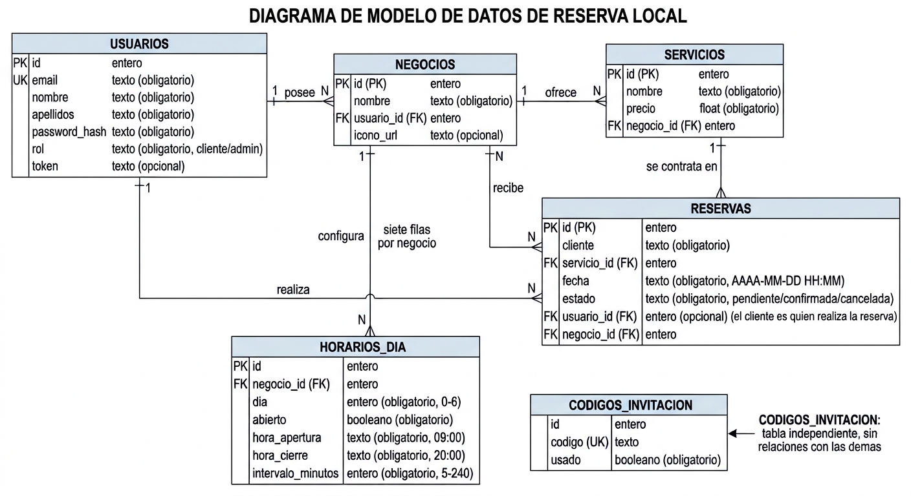

# ReservaLocal API

API RESTful para ReservaLocal, un sistema de reservas adaptable a cualquier
negocio local (peluquerías, barberías, clínicas...). Cada negocio define sus
propios servicios y su horario semanal, y los clientes reservan cita online.
La instancia desplegada incluye una peluquería como ejemplo.


## Cuentas de prueba

Se crean al visitar `/setup`.

| Rol | Email | Contraseña |
|---|---|---|
| Admin | `admin@reservalocal.com` | `Admin123.` |
| Admin | `admin2@reservalocal.com` | `Admin123.` |
| Cliente | `cliente@reservalocal.com` | `Cliente123!` |

Código maestro para crear negocios nuevos al registrarse: `1234`

## Endpoints de la API

| Método | Ruta | Qué hace |
|---|---|---|
| GET | `/` | Estado de la API |
| GET | `/setup` | Crea las tablas y carga los datos de ejemplo |
| GET | `/reset-forzado` | Borra todas las tablas (para empezar de cero) |
| POST | `/login` · `/logout` | Entrar y salir (devuelve un token) |
| POST | `/registro` | Crear cuenta (cliente, o admin si usa código) |
| GET | `/negocios` · `/negocios/mios` | Listar negocios |
| POST / DELETE | `/negocios/<id>/foto` | Subir o quitar el icono del negocio |
| GET / PUT | `/horario` | Ver o editar el horario semanal |
| GET | `/horarios/disponibles` | Horas libres de un día concreto |
| GET / POST | `/servicios` | Listar o crear servicios |
| PUT / DELETE | `/servicios/<id>` | Editar o borrar un servicio |
| GET / POST | `/reservas` | Listar o crear reservas |
| PUT / DELETE | `/reservas/<id>` | Editar o borrar una reserva |

## Reglas que aplica el servidor

- No se puede reservar en el pasado ni con más de 1 mes de antelación.
- Un cliente no puede tener dos reservas activas del mismo servicio en el mismo negocio.
- El administrador solo confirma o cancela; nunca cambia la fecha de una reserva.
- Cada usuario solo ve y modifica sus propios datos, o los de su negocio si es admin.
- Una misma hora no se puede reservar dos veces (conflicto → 409).

## Códigos de respuesta

- `200 / 201` todo correcto
- `400` datos incorrectos o incompletos
- `401` sin sesión válida
- `403` sin permiso para esa acción
- `404` el recurso no existe
- `409` conflicto (hora ocupada o servicio ya reservado)

## Cómo ejecutarlo en local

1. Clona este repositorio.
2. Crea y activa un entorno virtual: `python -m venv venv`.
3. Instala las dependencias: `pip install -r requirements.txt`.
4. Crea un archivo `.env` (nunca se sube a GitHub) con tus credenciales:

```
DB_USER=tu_usuario
DB_PASSWORD=tu_password
DB_HOST=tu_host
DB_PORT=4000
DB_NAME=tu_base_de_datos
```

O usa SQLite local definiendo `DATABASE_URL=sqlite:///reservalocal.db`.

5. Arranca el servidor: `python app.py`.
6. Abre `http://localhost:5000/reset-forzado` y luego `/setup` una vez para
   crear las tablas y los datos de prueba.

## Despliegue

Alojado en PythonAnywhere con configuración WSGI manual. En producción se usa
SQLite porque el plan gratuito bloquea los puertos MySQL salientes; en
desarrollo se usa un clúster de TiDB Cloud compatible con MySQL. El mismo
esquema y el mismo código funcionan en ambos entornos.<br><br><br>


## DIAGRAMA



## PARTE TÉCNICA

### Lenguajes y librerías

| Elemento | Para qué se usa |
|---|---|
| Python 3.10 | Lenguaje en el que está escrito todo el backend |
| Flask | Framework web que sirve la API y gestiona las rutas |
| Flask-Cors | Permite que el frontend, alojado en otro dominio, llame a la API |
| Flask-SQLAlchemy | ORM: maneja la base de datos mediante clases de Python |
| PyMySQL | Driver para conectar con MySQL / TiDB Cloud |
| python-dotenv | Lee las credenciales del archivo `.env` sin subirlas a Git |
| certifi | Certificados SSL para la conexión segura a la base de datos |
| Werkzeug | Cifra y comprueba las contraseñas (nunca se guardan en claro) |

### Base de datos

- En **producción** (PythonAnywhere) se usa **SQLite**, porque el plan gratuito
  bloquea los puertos MySQL salientes.
- En **desarrollo** se usa **TiDB Cloud**, compatible con MySQL.
- Gracias a SQLAlchemy, el mismo código y el mismo esquema funcionan en ambos
  entornos sin cambios.

### Distribución de los archivos

```
Reserva_Local_Backend/
├── app.py             Todo el backend en un solo archivo, organizado por bloques
├── requirements.txt   Dependencias de Python
├── .env               Credenciales de la base de datos
├── uploads/           Iconos que suben los negocios
└── README.md          Documentación
```

### Cómo se organiza el código dentro de `app.py`

Aunque todo vive en un único archivo, está separado en bloques claros, de
arriba abajo:

1. **Configuración**: lectura del `.env`, conexión a la base de datos y constantes.
2. **Modelos**: las seis tablas como clases de SQLAlchemy.
3. **Seguridad**: lectura del token y los decoradores `requiere_login` y `requiere_admin`.
4. **Helpers**: funciones de fechas y horarios (generar slots, detectar pasado, tope de un mes).
5. **Rutas**: los endpoints de la API, agrupados por recurso (negocios, horarios, servicios, reservas, auth).